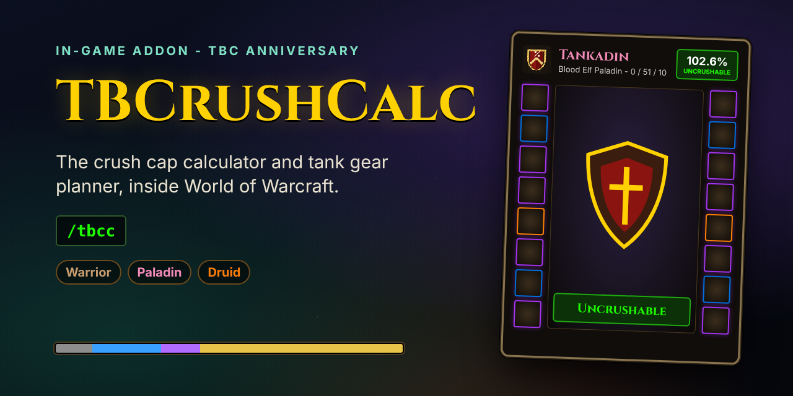

<p align="center">
  
</p>

<p align="center">
  <a href="https://github.com/kcham01/TBCrushCalc-Addon/raw/results/TBCrushCalc.zip"></a>
  <a href="#install"></a>
  <a href="https://github.com/kcham01/TBCrushCalc"></a>
  <br>
  <a href="https://github.com/kcham01/TBCrushCalc-Addon/issues/new?title=Bug:%20&labels=bug"></a>
  <a href="https://github.com/kcham01/TBCrushCalc-Addon/issues/new?title=Idea:%20&labels=enhancement"></a>
  <a href="https://www.reddit.com/r/classicwow/submit?url=https%3A%2F%2Fgithub.com%2Fkcham01%2FTBCrushCalc-Addon&title=TBCrushCalc%3A%20an%20in-game%20crush%20cap%20calculator%20and%20gear%20planner%20for%20TBC%20Anniversary%20tanks"></a>
  <a href="https://github.com/kcham01/TBCrushCalc-Addon"></a>
</p>

**TBCrushCalc**<sup><sub> (calc is short for calculator btw)</sub></sup> is a World of Warcraft addon for Burning Crusade tanks on the **TBC Anniversary** realms. Put gear on a character pane, spend talent points, pick your raid buffs and the boss, and it tells you whether that boss can still land crushing blows and crits on you, how hard it hits, and what would fix it. Type **/tbcc** in game.

It is the [TBCrushCalc phone app](https://github.com/kcham01/TBCrushCalc), one for one, inside the game: the same screens, the same data (every TBC item, gem, enchant, consumable and raid boss) and the same maths, tested against the app on hundreds of characters. Protection warriors, protection paladins and feral druids.

<p align="center">
  
  
  
</p>

## What it does

- **Character pane.** All the equipment slots around your character, with quality colours, gem and enchant markers and the game's own item tooltips. When the character is the race you're playing, the middle shows your character in 3D wearing the gear you planned (drag to turn, scroll to zoom). Stat panels for base stats, defenses, melee, ranged (warriors) and spells (paladins and druids).
- **Every TBC item.** All 14,000+ items a warrior, paladin or druid can wear. Filter by phase, required level and armor type, search by name or boss, and sort by how much avoidance each item adds.
- **Gems and enchants.** Every gem for a socket (matching colours first) and every enchant, armor kit and glyph for a slot. Ones that can't go on an item stay in the list with the reason, like "Requires a level 35 or higher item (this one is level 13)".
- **Talents.** The three trees as in the game's talent frame: 61 points, rows unlocked every 5 points, prerequisite arrows. Click for details, right-click to take a point out.
- **Buffs.** Drop-downs with every flask, elixir, food, scroll and potion (a flask closes the elixir slots). Raid buffs, boss debuffs and world buffs as icon grids by class: click for on, again for the talented version, right-click for details. Your stances, cooldowns and on-use trinkets.
- **The fight.** 66 TBC raid bosses with their level, swing speed, two-weapon attacks, hit size and abilities.
- **Caps.** Crush cap (gear only, with your block cooldown, with procs), the attack table, damage taken (hits after armor and blocks, damage per second, effective health, hits to kill you), crit cap, Holy Shield / Shield Block charge coverage, Illidan's Shear, what closes the gap, and where every number comes from.
- **Your own character.** "Load the character I'm playing" reads your gear, gems, enchants and talents straight from the game.
- **Alts and share codes.** Save as many characters as you like for your whole account. Share codes are the app's own, so a character moves between the phone and the game both ways.

## Install

1. Download [TBCrushCalc.zip](https://github.com/kcham01/TBCrushCalc-Addon/raw/results/TBCrushCalc.zip).
2. Unzip it into `World of Warcraft\_anniversary_\Interface\AddOns`. You should end up with two folders there: `TBCrushCalc` and `TBCrushCalc_Data`.
3. Start the game (or `/reload`) and make sure both are ticked in the AddOns list on the character screen.
4. Type `/tbcc` or click the shield on the minimap.

`/tbcc load` loads the character you're playing; `/tbcc minimap` hides or shows the minimap button. The item data (TBCrushCalc_Data) only loads the first time you open the window, so the addon costs next to nothing until you use it.

## The maths, briefly

A boss swing is one roll, read in order: miss, dodge, parry, block, crit, crushing blow, hit. A level 73 boss takes 0.6% off each of your miss, dodge, parry and block, so your character sheet needs **102.4%** combined before crushing blows (15% of swings, at 150% damage) fall off the table. Each defense point above 350 removes 0.04% of the boss's 5.6% crit chance: 490 defense for warriors and paladins, 415 for a druid with 3/3 Survival of the Fittest.

## How it's checked

Every build:

- rebuilds the addon's data from the app and fails if it differs;
- runs 400 random characters (gear, gems, enchants, talents, buffs, consumables, cooldowns, bosses) through both the app's engine and the addon's Lua engine and checks every number matches, including the block charge simulation;
- checks the wowsims/tbc reference tanks and the in-game naked character values, as the app does;
- checks the addon only uses what the TBC Anniversary client has, against Blizzard's own interface code and API documentation;
- loads the addon into a stand-in for the game, clicks through every screen and panel, checks nothing errors or leaks frames, and draws every screen (the pictures above).

## Building it yourself

```
npm ci
node tools/export_data.mjs ../TBCrushCalc        # the data, from a checkout of the app
node tools/oracle.mjs ../TBCrushCalc && lua5.1 tests/run.lua
lua5.1 tests/ui.lua && node tools/render.mjs build/shots
```

## Licence

GPL-3.0-or-later. See [LICENSE](LICENSE).

## Credits

| Software / data | Used for | Licence |
| --- | --- | --- |
| [TBCrushCalc](https://github.com/kcham01/TBCrushCalc) | The data and the engine this addon is a port of | GPL-3.0 |
| [wowsims/tbc](https://github.com/wowsims/tbc) | Items, gems, enchants, base stats, reference characters for the tests | MIT |
| [cmangos tbc-db](https://github.com/cmangos/tbc-db), [mangos-tbc](https://github.com/cmangos/mangos-tbc) | Items, consumables, bosses, the block value formula | GPL-2.0 |
| [oppahansi/ltc](https://github.com/oppahansi/ltc) | Talent names, descriptions and icons | GPL-3.0 |
| [Gethe/wow-ui-source](https://github.com/Gethe/wow-ui-source) | Checking the addon against the client's interface code (not shipped) | Blizzard's |

World of Warcraft and The Burning Crusade are trademarks or registered trademarks of Blizzard Entertainment, Inc. TBCrushCalc is a fan-made addon and is not made, endorsed or supported by Blizzard Entertainment.
